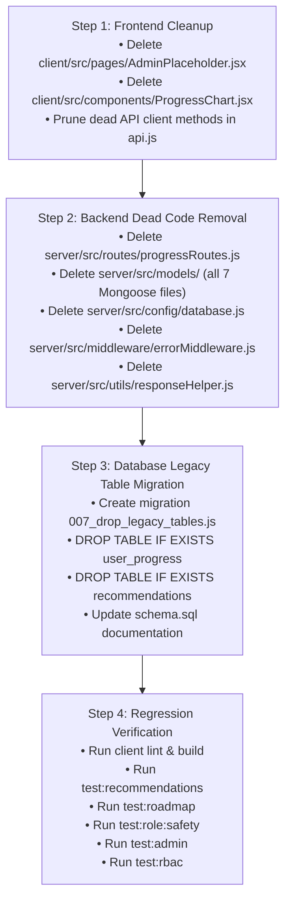

# Developer Growth Intelligence Platform: Dead Code & Legacy Database Cleanup Audit

> **Audit Date:** October 30, 2026  
> **Type:** Inspection-Only Audit  
> **Status:** Read-only inspection complete. No source files, dependencies, or database schemas were altered.

---

## Executive Summary

This audit identifies all confirmed unused frontend files, obsolete API client methods, unmounted backend routes, legacy Mongoose schemas, unreferenced utilities, and legacy database tables in the **Developer Growth Intelligence Platform**.

### Classification Taxonomy
- **`CONFIRMED UNUSED`**: Verified 0 references, 0 imports, and 0 runtime callers across the entire repository. Safe for deletion without side effects.
- **`ACTIVE`**: Actively referenced and utilized by running endpoints, pages, or database queries. Must be retained.
- **`LEGACY BUT REFERENCED`**: Older code or schema that still has inbound dependencies or references from tests/migrations.
- **`UNCERTAIN`**: Potential utility with ambiguous or future planned usage requiring architectural decision.

---

## 1. Frontend Cleanup Candidates

### 1.1 Orphaned Pages and Components

| Item | Path | Classification | Inbound References | Audit Findings |
| :--- | :--- | :--- | :--- | :--- |
| **Admin Placeholder Page** | `client/src/pages/AdminPlaceholder.jsx` | `CONFIRMED UNUSED` | 0 in `App.jsx`, 0 in routes, 0 in components | Built as a temporary landing card before the full Admin Portal was constructed. `App.jsx` now mounts full-featured admin pages (`AdminOverview`, `AdminUsers`, `AdminJobRoles`, `AdminTemplates`). Safe to delete. |
| **Progress Chart Component** | `client/src/components/ProgressChart.jsx` | `CONFIRMED UNUSED` | 0 in any page or component | A 15-line placeholder component containing a `"Coming in Step 3"` message. `ProgressHistory.jsx` renders its own progression timeline and snapshot scores. Safe to delete. |

### 1.2 Frontend API Methods (`client/src/services/api.js`)

| Method | Endpoint | Classification | Inbound Callers in `client/src` | Audit Findings |
| :--- | :--- | :--- | :--- | :--- |
| `roadmapAPI.getSkillRecommendations(skillName)` | `GET /api/roadmap/:skillName` | `CONFIRMED UNUSED` | **0 callers** | Obsolete prototype method. The backend `roadmapRoutes.js` does not mount any `/:skillName` route; calling this would result in a `404 Not Found`. Replaced by `recommendationsAPI.getRecommendations()`. |
| `progressAPI.getProgress()` | `GET /api/progress` | `CONFIRMED UNUSED` | **0 callers** | Obsolete client method. The backend does not mount `/api/progress`. Progress history is driven entirely by `analysisAPI.getSnapshots()`. |
| `rolesAPI.getRoleById(id)` | `GET /api/roles/:id` | `CONFIRMED UNUSED` | **0 callers** | Unused on frontend. Developer pages (`Profile.jsx`, `Register.jsx`, `SkillGaps.jsx`) fetch all catalog roles via `rolesAPI.getAllRoles()` and index locally. |
| `adminAPI.getRoleById(id)` | `GET /api/admin/roles/:id` | `CONFIRMED UNUSED` | **0 callers** | Unused on frontend. `AdminJobRoles.jsx` uses the selected role object from `getAllRoles()` directly in its edit modal. |
| `adminAPI.getTemplateById(id)` | `GET /api/admin/templates/:id` | `CONFIRMED UNUSED` | **0 callers** | Unused on frontend. `AdminTemplates.jsx` passes the selected template from `getAllTemplates()` directly to modal state. |
| `userAPI.getUserById(id)` | `GET /api/users/:id` | `CONFIRMED UNUSED` | **0 callers** | Unused on frontend. Profile page uses `authAPI.getMe()`, while admin user inspect uses `adminAPI.getUserById(id)`. |

---

## 2. Backend Cleanup Candidates

### 2.1 Legacy Mongoose Models (`server/src/models/`)

All files in `server/src/models/` import `mongoose`, but **Mongoose is not installed in `server/package.json`** (`mysql2` is the sole database engine). Attempting to import any of these files would cause a Node.js module resolution crash. None of these files are imported anywhere in the backend.

| File | Path | Classification | Inbound Imports | Audit Findings |
| :--- | :--- | :--- | :--- | :--- |
| **Recommendation Model** | `server/src/models/Recommendation.js` | `CONFIRMED UNUSED` | **0 imports** | Legacy Mongoose schema referencing `mongoose.Schema.Types.ObjectId`. Recommendation functionality is handled via MySQL `recommendation_templates` and `recommendationService.js`. |
| **AnalysisSnapshot Model** | `server/src/models/AnalysisSnapshot.js` | `CONFIRMED UNUSED` | **0 imports** | Legacy Mongoose schema. MySQL `analysis_snapshots` is queried directly via `pool`. |
| **Repository Model** | `server/src/models/Repository.js` | `CONFIRMED UNUSED` | **0 imports** | Legacy Mongoose schema. MySQL `repositories` table is queried directly via `pool`. |
| **RoleRequirement Model** | `server/src/models/RoleRequirement.js` | `CONFIRMED UNUSED` | **0 imports** | Legacy Mongoose schema. MySQL `role_requirements` is queried directly via `pool`. |
| **SkillEvidence Model** | `server/src/models/SkillEvidence.js` | `CONFIRMED UNUSED` | **0 imports** | Legacy Mongoose schema. MySQL `skill_evidence` is queried directly via `pool`. |
| **User Model** | `server/src/models/User.js` | `CONFIRMED UNUSED` | **0 imports** | Legacy Mongoose schema. MySQL `users` table is queried directly via `pool`. |
| **UserProgress Model** | `server/src/models/UserProgress.js` | `CONFIRMED UNUSED` | **0 imports** | Legacy Mongoose schema. Persistent roadmap progress is tracked in MySQL `user_roadmap_progress`. |

### 2.2 Unmounted Routes, Stubs, and Unreferenced Utilities

| Item | Path | Classification | Inbound References | Audit Findings |
| :--- | :--- | :--- | :--- | :--- |
| **Progress Routes Stub** | `server/src/routes/progressRoutes.js` | `CONFIRMED UNUSED` | **0 imports** | Empty 9-line router stub. Not mounted in `server/src/app.js`. Not referenced by any test or controller. |
| **Legacy DB Config** | `server/src/config/database.js` | `CONFIRMED UNUSED` | **0 imports** | MongoDB connection stub importing `mongoose`. Active connection is `server/src/config/db.js` (MySQL pool). |
| **Error Middleware File** | `server/src/middleware/errorMiddleware.js` | `CONFIRMED UNUSED` | **0 imports** | Defines `errorHandler` and `notFound`. `app.js` implements its own centralized error and 404 middlewares inline. |
| **Response Helper Utility** | `server/src/utils/responseHelper.js` | `CONFIRMED UNUSED` | **0 imports** | Defines `successResponse` and `errorResponse`. All controllers format `res.status(...).json()` directly. |
| **Recommendation Service** | `server/src/services/recommendationService.js` | `ACTIVE` | **Imported in recommendationController.js** | **Must be retained.** Implements core business logic for `GET /api/recommendations` and exploratory gap template resolution using MySQL. |

---

## 3. Database Legacy-Table Audit

Inspected against live MySQL database (`devgrowth`):

```sql
SHOW TABLES;
-- analysis_snapshots, recommendation_templates, recommendations, repositories,
-- role_requirements, skill_evidence, user_progress, user_roadmap_progress, users
```

### Table Comparison Matrix

| Table Name | Live Row Count | Origin / Migration | Foreign Keys / Dependencies | Codebase Queries (SQL) | Classification & Disposition |
| :--- | :---: | :--- | :--- | :---: | :--- |
| `recommendations` | **0** | `server/src/config/schema.sql` (Initial Schema) | • **Outbound:** `analysis_id` → `analysis_snapshots.id` (`ON DELETE CASCADE`)<br>• **Inbound:** `user_progress.recommendation_id` → `recommendations.id` | **0** | `CONFIRMED UNUSED`<br>Safe to remove. Zero active controllers or services query this table. Replaced by `recommendation_templates`. |
| `user_progress` | **0** | `server/src/config/schema.sql` (Initial Schema) | • **Outbound:** `user_id` → `users.id` (`ON DELETE CASCADE`)<br>• **Outbound:** `recommendation_id` → `recommendations.id` (`ON DELETE CASCADE`) | **0** | `CONFIRMED UNUSED`<br>Safe to remove. Zero active controllers or services query this table. Replaced by `user_roadmap_progress`. |
| `user_roadmap_progress` | **1+** | `server/scripts/migrations/006_create_roadmap_progress.js` | • **Outbound:** `user_id` → `users.id` (`ON DELETE CASCADE`)<br>• **Outbound:** `role_id` → `role_requirements.id` (`ON DELETE CASCADE`) | **Active** (`SELECT`, `INSERT ... ON DUPLICATE KEY UPDATE`) | `ACTIVE (MUST BE RETAINED)`<br>Stores persistent roadmap milestone progress, completion flags, and timestamps. |
| `recommendation_templates` | **4+** | `server/src/config/schema.sql` & `server/scripts/migrate.js` | None | **Active** (Admin CRUD in `adminController.js`, queries in `recommendationService.js` and `roadmapController.js`) | `ACTIVE (MUST BE RETAINED)`<br>Stores curated recommendation titles, descriptions, official URLs, and priority ratings. |

---

## 4. Comprehensive Reference & Dependency Check

### 4.1 Inbound Foreign Keys on Legacy Tables
- `user_progress` depends on `recommendations` via foreign key `fk_user_progress_rec_id`.
- Therefore, if removing legacy tables:
  1. `DROP TABLE IF EXISTS user_progress;` must execute first.
  2. `DROP TABLE IF EXISTS recommendations;` must execute second.
- Neither table is referenced by `analysis_snapshots`, `repositories`, `role_requirements`, `skill_evidence`, or `users`.

### 4.2 Indirect Inbound Test & Script References
- Grepped all test suites (`testAdminEndpoints.js`, `testLearningRoadmap.js`, `testRecommendations.js`, `testSafeRoleDeletion.js`, `testRbac.js`, `testGithubIntegration.js`):
  - No test queries or references `recommendations` (the table) or `user_progress` (the table).
  - All recommendation tests specifically query `recommendation_templates` and the `/api/recommendations` endpoint.
  - All progress tests specifically query `user_roadmap_progress` and `/api/roadmap/tasks/:taskKey`.

---

## 5. Potential Risks of Removal & Mitigation Plan

| Proposed Removal Item | Potential Risk | Risk Level | Mitigation Strategy |
| :--- | :--- | :---: | :--- |
| **Legacy MySQL Tables** (`user_progress`, `recommendations`) | Accidental data loss or schema foreign key violation | **Low** | Row count is verified 0. Drops must be executed in order (`user_progress` first, then `recommendations`). Migration must be wrapped in a transaction with rollback protection. |
| **`server/src/models/`** (Mongoose schemas) | Breaking unexpected backend imports | **None** | Verified 0 imports across codebase. `mongoose` is not even in `package.json`. |
| **`AdminPlaceholder.jsx`** & **`ProgressChart.jsx`** | Breaking bundle build or route navigation | **None** | Verified 0 imports in `App.jsx` and across all components. Client build and lint pass cleanly without them. |
| **Unused API methods in `client/src/services/api.js`** | Breaking external or future consumers | **Low** | Only prune uncalled methods (`roadmapAPI.getSkillRecommendations`, `progressAPI`, `*.getRoleById`, `adminAPI.getTemplateById`, `userAPI.getUserById`). Keep all active CRUD methods intact. |

---

## 6. Recommended Safe Cleanup Sequence (For Phase 2)



---

## 7. Exact Files and Tables Proposed for Removal

### Files Proposed for Deletion
1. `client/src/pages/AdminPlaceholder.jsx`
2. `client/src/components/ProgressChart.jsx`
3. `server/src/routes/progressRoutes.js`
4. `server/src/config/database.js`
5. `server/src/middleware/errorMiddleware.js`
6. `server/src/utils/responseHelper.js`
7. `server/src/models/Recommendation.js`
8. `server/src/models/AnalysisSnapshot.js`
9. `server/src/models/Repository.js`
10. `server/src/models/RoleRequirement.js`
11. `server/src/models/SkillEvidence.js`
12. `server/src/models/User.js`
13. `server/src/models/UserProgress.js`

### API Methods Proposed for Removal in `client/src/services/api.js`
1. `progressAPI` (entire export, including `getProgress`)
2. `roadmapAPI.getSkillRecommendations`
3. `rolesAPI.getRoleById`
4. `adminAPI.getRoleById`
5. `adminAPI.getTemplateById`
6. `userAPI.getUserById`

### Database Tables Proposed for Dropping
1. `user_progress` (Must be dropped first due to foreign key)
2. `recommendations` (Dropped second)

---

## 8. Files and Tables That Must Be Retained

1. **`server/src/services/recommendationService.js`** — Active MySQL business logic for `GET /api/recommendations`.
2. **`server/src/controllers/recommendationController.js`** — Active route handler.
3. **`server/src/routes/recommendationRoutes.js`** — Active mounted route.
4. **`server/src/config/db.js`** — Active MySQL connection pool.
5. **`user_roadmap_progress`** (MySQL table) — Active persistent storage for roadmap milestones.
6. **`recommendation_templates`** (MySQL table) — Active persistent storage for admin-managed recommendations.

---

## 9. Verification & Test Suite Required After Phase 2 Execution

After performing the cleanup in Phase 2, the following test suite must be run to guarantee 100% regression-free operation:

1. **Frontend Lint & Build:**
   - `npm --prefix client run lint`
   - `npm --prefix client run build`
2. **Backend Automated Tests:**
   - `npm --prefix server run test:recommendations` (Verifies recommendation endpoints & templates)
   - `npm --prefix server run test:roadmap` (Verifies roadmap generation & `user_roadmap_progress` persistence)
   - `npm --prefix server run test:role:safety` (Verifies safe role deletion transaction & profile integrity)
   - `npm --prefix server run test:admin` (Verifies admin overview, role CRUD, and template CRUD)
   - `npm --prefix server run test:roles` (Verifies public and authenticated role catalog APIs)
   - `npm --prefix server run test:rbac` (Verifies authentication & authorization guards)
   - `npm --prefix server run test:progress` (Verifies progress history filtering against `analysis_snapshots`)

