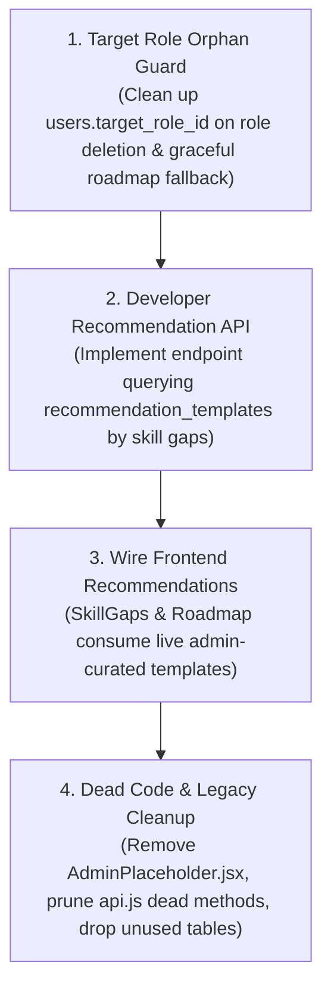

# JobPortal (DevGrowth) — Complete System-Wide Integration Audit

**Audit Date**: October 30, 2026  
**Scope**: Full Stack Integration (React Frontend + Node.js/Express Backend + MySQL + GitHub OAuth)  
**Execution Mode**: Inspection and Live Automated/Browser Test Execution Only (Zero code or schema modifications)  

---

## 1. Executive Summary

A comprehensive system-wide integration audit was performed across all functional pillars of the **Developer Growth Platform (JobPortal / DevGrowth)**.

### High-Level Verdict
- **Core Platform (GitHub OAuth, Repositories, Skill Analysis, Role Matching, Profile, Progress History, Learning Roadmap, RBAC & Admin Portal)**: **PASS ✅**. Fully implemented, database-backed, robustly isolated, and verified through both 516 automated test assertions and 34 real-browser (Google Chrome CDP) end-to-end interactions with 0 failures.
- **Recommendation Subsystem (Admin Templates → Developer Recommendations)**: **PARTIAL / ARCHITECTURAL GAP ⚠️**. While administrators can manage recommendation templates via `/admin/templates` and developers view recommendations in Skill Gaps and the Learning Roadmap, **the admin-managed templates are never integrated into the developer-facing recommendation generation**. The developer frontend relies on hardcoded strings or generic templates, while `server/src/services/recommendationService.js` remains an uncalled stub throwing `Not yet implemented`, and the MySQL `recommendations` and `user_progress` tables sit with 0 rows.
- **Data Integrity & Schema Constraints**: **PASS with 1 Minor Weakness**. Relational cascading deletes cleanly purge dependent records for users and repositories. However, `users.target_role_id` lacks a formal foreign key constraint referencing `role_requirements(id)`.

---

## 2. Integration Status Across the Nine Areas

| Section | Area | Status | Summary |
| :--- | :--- | :---: | :--- |
| **§ 1** | GitHub Integration → Skill Analysis | **PASS** | OAuth, repository sync, ownership filtering, evidence extraction, deduplication, and safe disconnect all work cleanly. |
| **§ 2** | Skill Analysis → Skill Gaps | **PASS** | Live detected skills compared against role benchmarks; role selection is decoupled from Profile saved role; honest coverage metrics. |
| **§ 3** | Profile → Progress History | **PASS** | Saved Profile target role strictly filters historical snapshots; switching roles displays role-specific history while preserving old snapshots. |
| **§ 4** | Profile → Learning Roadmap | **PASS** | Dynamic roadmap generated from saved Profile role; stage grouping; persistent task status in `user_roadmap_progress`; independent progress per role. |
| **§ 5** | Skill Analysis → Recommendations | **PARTIAL** | Recommendations display in Skill Gaps and Roadmap, but admin-configured `recommendation_templates` are NOT consumed; `recommendationService.js` is an uncalled stub. |
| **§ 6** | Admin Portal → Developer Portal | **PARTIAL** | Admin changes to **Job Roles** (`role_requirements`) immediately update developer role selection & gap analysis; admin changes to **Templates** have no effect on developers. |
| **§ 7** | Database and Data Integrity | **PASS** | Strong FK cascading deletes across users, repositories, evidence, snapshots, and roadmap progress; zero data loss on GitHub disconnect. Missing FK on `users.target_role_id`. |
| **§ 8** | API and Frontend Integration | **PASS** | Centralized API client with automatic token attachment and 401 expiration handling. Two dead/unmounted API endpoints identified (`getSkillRecommendations`, `/progress`). |
| **§ 9** | Automated & Browser Testing | **PASS** | 516 automated backend test assertions passed (0 failed); 34 real-browser Chrome CDP interactions passed (0 failed). |

---

## 3. Detailed Results & Verification Findings

### § 1. GitHub Integration → Skill Analysis (PASS)
- **OAuth Account Linking**: Protected under `GET /api/auth/github` with state signature validation, replay prevention, and account conflict protection. Verified via `test:oauth` (21 tests).
- **Repository Synchronization**: `POST /api/github/sync` validates username, fetches repositories, and updates `repositories` table. Ownership filtering strictly isolates owned personal repositories and personal forks from third-party collaborations. Verified via `test:github` (33 tests) and `test:ownership` (33 tests).
- **Skill Extraction**: `skillDetectionService.js` extracts signals from languages, manifests (`package.json`, `pom.xml`), and configuration files (`Dockerfile`, `.github/workflows`, `docker-compose.yml`, `Jenkinsfile`). Combines multi-signal confidence scores without exceeding caps. Verified via `test:skills` (100 tests).
- **Evidence Storage & Idempotency**: Evidence is stored in `skill_evidence`. Re-running analysis cleanly purges previous evidence for the analyzed repositories before inserting fresh evidence, avoiding duplicates. Verified via `test:persistence` (90 tests).
- **Disconnect Safety**: `POST /api/auth/github/disconnect` clears `github_id`, `github_username`, and `github_access_token` on the user record. It does **not** delete repositories, skill evidence, or analysis snapshots.

### § 2. Skill Analysis → Skill Gaps (PASS)
- **Skill Analysis**: `GET /api/skills` returns aggregated skills with confidence scores, categories, and contributing repository counts. `GET /api/skills/:skillName` returns specific file/manifest breakdown.
- **Exploratory Role Decoupling**: Selecting an exploratory role in `SkillGaps.jsx` updates local React state (`selectedRoleKey`) only. It does NOT invoke `userAPI.updateTargetRole` or mutate the user's saved Profile role unless the user explicitly clicks the "Set as primary target role" button.
- **Benchmark Matching**: `skillMatcher.js` uses strict boundary normalization (preventing false matches like `'C'` matching `'JavaScript'`) and handles compound competencies (e.g. `'PyTorch / TensorFlow'`).
- **Readiness Honesty**: Snapshot summaries and UI badges explicitly describe the score as an `"evidence coverage ratio — reflects observable code signals, not measured proficiency"`.

### § 3. Profile → Progress History (PASS)
- **Profile Persistence**: Target role name and ID are persisted in `users.target_role` and `users.target_role_id` via `PATCH /api/users/:id/target-role`. Preserved across sessions and token refresh.
- **Progress History Filtering**: `ProgressHistory.jsx` queries `GET /api/analysis/snapshots?targetRole=...`. The backend filters snapshots by the requested role; the frontend double-checks the filter.
- **Snapshot Preservation**: Switching from Java to Python displays Python history. Switching back to Java completely restores previous Java snapshots intact. Verified via `test:progress` (22 tests).

### § 4. Profile → Learning Roadmap (PASS)
- **Dynamic Generation**: `GET /api/roadmap` queries `role_requirements` for the user's saved Profile target role. Java, Python Data Engineer, and Frontend Developer generate distinct, role-appropriate competencies and capstones.
- **Structured Stages**: Tasks are categorized into 4 stages: *Foundations*, *Core Technologies*, *Advanced Concepts*, and *Practical Projects*.
- **Skill Evidence Awareness**: Detected repository evidence sets `evidenceStatus: "Evidence Detected"`. Crucially, evidence **never** auto-completes a learning task (`status` remains `NOT_STARTED` until the user manually changes it).
- **Progress Persistence**: `PATCH /api/roadmap/tasks/:taskKey` upserts into `user_roadmap_progress` with `(user_id, role_id, task_key)`. State survives logout/login and browser reloads. Verified via `test:roadmap` (34 tests).

### § 5. Skill Analysis → Recommendations (PARTIAL / ARCHITECTURAL GAP)
- **Origin of Recommendations**:
  - In `SkillGaps.jsx`, recommendation text originates from a static frontend dictionary (`CAREER_TRACKS`) for 3 roles, and string interpolation (`Demonstrate ${s.name} in your repositories...`) for all other 31 roles.
  - In `roadmapController.js`, deliverable advice is generated by `getDeliverable(skillName, category)` and documentation links from `RESOURCE_MAP`.
- **Admin Template Disconnection**:
  - The `recommendation_templates` table managed by Admins via `/admin/templates` is **never queried** by any developer-facing API or component.
  - `server/src/services/recommendationService.js` contains a placeholder function that throws `generateRecommendations - Not yet implemented`.
  - `server/src/models/Recommendation.js` is an unmigrated Mongoose schema.
  - The MySQL `recommendations` and `user_progress` tables exist with 0 rows and 0 queries referencing them in the backend.

### § 6. Admin Portal → Developer Portal (PARTIAL)
- **Job Role Synchronization**: When an admin creates or edits a role via `POST /api/admin/roles` or `PUT /api/admin/roles/:id`, the record is written to `role_requirements`. Because developer features (`/api/roles`, `/api/roadmap`, Profile, Skill Gaps) query `role_requirements` dynamically, **admin job role changes immediately take effect across the developer portal**.
- **Template Synchronization**: Admin changes to `recommendation_templates` remain localized to the admin portal and do not reach developers.
- **Access Control & Safeguards**: Non-admins receive `403 Forbidden` on all `/api/admin/*` endpoints. Browser route guards redirect non-admins to `/`. Self-deactivation, self-demotion, and last-admin lockout protections are fully active.

### § 7. Database and Data Integrity (PASS with 1 Minor Weakness)
- **Foreign Keys**:
  - `repositories.user_id` → `users.id` (ON DELETE CASCADE)
  - `skill_evidence.repository_id` → `repositories.id` (ON DELETE CASCADE)
  - `analysis_snapshots.user_id` → `users.id` (ON DELETE CASCADE)
  - `analysis_snapshots.target_role_id` → `role_requirements.id` (ON DELETE RESTRICT — blocks deleting roles with snapshots)
  - `user_roadmap_progress.user_id` → `users.id` (ON DELETE CASCADE)
  - `user_roadmap_progress.role_id` → `role_requirements.id` (ON DELETE CASCADE)
- **Identified Weakness**: `users.target_role_id` has an index (`idx_users_target_role_id`) but **no foreign key constraint** referencing `role_requirements.id`. If a role that has no snapshots is deleted by an admin, any user with that `target_role_id` will have an invalid reference, causing `GET /api/roadmap` to return a 404 error.

### § 8. API and Frontend Integration (PASS)
- **Token Management**: JWT tokens stored in `sessionStorage`. On `401 Unauthorized`, an `auth:expired` event is dispatched, clearing state and logging the user out.
- **Dead / Unmounted Endpoints**:
  1. `roadmapAPI.getSkillRecommendations(skillName)` in `client/src/services/api.js` points to `/roadmap/:skillName`, which is not registered in `roadmapRoutes.js` (uncalled by frontend).
  2. `progressAPI.getProgress()` in `client/src/services/api.js` points to `/progress`, which is an unmounted placeholder route `progressRoutes.js` (uncalled; `ProgressHistory.jsx` uses `analysisAPI.getSnapshots`).

### § 9. Automated & Browser Testing (PASS)
- **Backend Automated Suites**: 11 test suites executed, **516 passed, 0 failed**.
- **Real Browser (Chrome CDP) E2E Suite**: 34 interaction checks executed, **34 passed, 0 failed**.

---

## 4. File Paths Involved

### Backend Architecture
- **Server Entry & App**: [`server/src/server.js`](file:///d:/Projects/developer-growth-platform/server/src/server.js), [`server/src/app.js`](file:///d:/Projects/developer-growth-platform/server/src/app.js)
- **Configuration & Database**: [`server/src/config/db.js`](file:///d:/Projects/developer-growth-platform/server/src/config/db.js)
- **Middleware**: [`server/src/middleware/authMiddleware.js`](file:///d:/Projects/developer-growth-platform/server/src/middleware/authMiddleware.js)
- **Controllers**:
  - Auth & OAuth: [`server/src/controllers/authController.js`](file:///d:/Projects/developer-growth-platform/server/src/controllers/authController.js), [`server/src/controllers/githubAuthController.js`](file:///d:/Projects/developer-growth-platform/server/src/controllers/githubAuthController.js)
  - Repositories: [`server/src/controllers/githubController.js`](file:///d:/Projects/developer-growth-platform/server/src/controllers/githubController.js)
  - Skill Analysis & Snapshots: [`server/src/controllers/analysisController.js`](file:///d:/Projects/developer-growth-platform/server/src/controllers/analysisController.js), [`server/src/controllers/skillController.js`](file:///d:/Projects/developer-growth-platform/server/src/controllers/skillController.js)
  - Roles: [`server/src/controllers/roleController.js`](file:///d:/Projects/developer-growth-platform/server/src/controllers/roleController.js)
  - Roadmap: [`server/src/controllers/roadmapController.js`](file:///d:/Projects/developer-growth-platform/server/src/controllers/roadmapController.js)
  - Admin: [`server/src/controllers/adminController.js`](file:///d:/Projects/developer-growth-platform/server/src/controllers/adminController.js)
  - Users: [`server/src/controllers/userController.js`](file:///d:/Projects/developer-growth-platform/server/src/controllers/userController.js)
- **Services & Analyzers**:
  - GitHub API: [`server/src/services/githubService.js`](file:///d:/Projects/developer-growth-platform/server/src/services/githubService.js)
  - Skill Detection: [`server/src/services/skillDetectionService.js`](file:///d:/Projects/developer-growth-platform/server/src/services/skillDetectionService.js), [`server/src/services/languageAnalyzer.js`](file:///d:/Projects/developer-growth-platform/server/src/services/languageAnalyzer.js), [`server/src/services/dependencyAnalyzer.js`](file:///d:/Projects/developer-growth-platform/server/src/services/dependencyAnalyzer.js), [`server/src/services/fileEvidenceAnalyzer.js`](file:///d:/Projects/developer-growth-platform/server/src/services/fileEvidenceAnalyzer.js)
  - Skill Matcher: [`server/src/utils/skillMatcher.js`](file:///d:/Projects/developer-growth-platform/server/src/utils/skillMatcher.js)
  - Stubs: [`server/src/services/recommendationService.js`](file:///d:/Projects/developer-growth-platform/server/src/services/recommendationService.js), [`server/src/models/Recommendation.js`](file:///d:/Projects/developer-growth-platform/server/src/models/Recommendation.js)

### Frontend Architecture
- **App & Router**: [`client/src/App.jsx`](file:///d:/Projects/developer-growth-platform/client/src/App.jsx), [`client/src/components/ProtectedRoute.jsx`](file:///d:/Projects/developer-growth-platform/client/src/components/ProtectedRoute.jsx)
- **Contexts**: [`client/src/context/AuthContext.jsx`](file:///d:/Projects/developer-growth-platform/client/src/context/AuthContext.jsx), [`client/src/context/ThemeContext.jsx`](file:///d:/Projects/developer-growth-platform/client/src/context/ThemeContext.jsx)
- **API Client**: [`client/src/services/api.js`](file:///d:/Projects/developer-growth-platform/client/src/services/api.js)
- **Developer Pages**:
  - [`client/src/pages/Dashboard.jsx`](file:///d:/Projects/developer-growth-platform/client/src/pages/Dashboard.jsx)
  - [`client/src/pages/GitHubRepositories.jsx`](file:///d:/Projects/developer-growth-platform/client/src/pages/GitHubRepositories.jsx)
  - [`client/src/pages/SkillAnalysis.jsx`](file:///d:/Projects/developer-growth-platform/client/src/pages/SkillAnalysis.jsx)
  - [`client/src/pages/SkillGaps.jsx`](file:///d:/Projects/developer-growth-platform/client/src/pages/SkillGaps.jsx)
  - [`client/src/pages/Profile.jsx`](file:///d:/Projects/developer-growth-platform/client/src/pages/Profile.jsx)
  - [`client/src/pages/ProgressHistory.jsx`](file:///d:/Projects/developer-growth-platform/client/src/pages/ProgressHistory.jsx)
  - [`client/src/pages/LearningRoadmap.jsx`](file:///d:/Projects/developer-growth-platform/client/src/pages/LearningRoadmap.jsx)
- **Admin Pages & Layout**:
  - [`client/src/components/admin/AdminLayout.jsx`](file:///d:/Projects/developer-growth-platform/client/src/components/admin/AdminLayout.jsx), [`client/src/components/admin/AdminSidebar.jsx`](file:///d:/Projects/developer-growth-platform/client/src/components/admin/AdminSidebar.jsx)
  - [`client/src/pages/admin/AdminOverview.jsx`](file:///d:/Projects/developer-growth-platform/client/src/pages/admin/AdminOverview.jsx)
  - [`client/src/pages/admin/AdminUsers.jsx`](file:///d:/Projects/developer-growth-platform/client/src/pages/admin/AdminUsers.jsx)
  - [`client/src/pages/admin/AdminJobRoles.jsx`](file:///d:/Projects/developer-growth-platform/client/src/pages/admin/AdminJobRoles.jsx)
  - [`client/src/pages/admin/AdminTemplates.jsx`](file:///d:/Projects/developer-growth-platform/client/src/pages/admin/AdminTemplates.jsx)
  - Unused: [`client/src/pages/AdminPlaceholder.jsx`](file:///d:/Projects/developer-growth-platform/client/src/pages/AdminPlaceholder.jsx)

---

## 5. API Endpoints & Database Tables Involved

### Active API Endpoints
| Namespace | Method | Path | Auth / Roles | Purpose |
| :--- | :---: | :--- | :---: | :--- |
| **Auth** | POST | `/api/auth/register` | Public | Enforces `USER` role; supports optional target role |
| **Auth** | POST | `/api/auth/login` | Public | Authenticates credentials; returns JWT token + user |
| **Auth** | GET | `/api/auth/me` | Authenticated | Returns current profile, target role, and GitHub link status |
| **Auth** | GET | `/api/auth/github` | Authenticated | Generates GitHub OAuth authorization URL with CSRF state |
| **Auth** | GET | `/api/auth/github/callback` | Public (OAuth) | Validates state, exchanges code for token, links account |
| **Auth** | POST | `/api/auth/github/disconnect` | Authenticated | Safely unlinks GitHub identity without data loss |
| **Users** | GET | `/api/users/:id` | Authenticated (Self/Admin) | Fetches account details (IDOR-protected) |
| **Users** | PATCH | `/api/users/:id/target-role` | Authenticated (Self/Admin) | Updates primary career target role and ID |
| **GitHub** | GET | `/api/github/repos` | Authenticated | Lists synchronized repositories (owned vs collaborations) |
| **GitHub** | POST | `/api/github/sync` | Authenticated | Syncs repositories from GitHub API with rate limit handling |
| **Skills** | GET | `/api/skills` | Authenticated | Aggregates detected skills, confidence, and categories |
| **Skills** | GET | `/api/skills/:skillName` | Authenticated | Returns file-level evidence records for a single skill |
| **Analysis**| POST | `/api/analysis/run` | Authenticated | Analyzes repos, extracts evidence, generates snapshots |
| **Analysis**| GET | `/api/analysis/snapshots` | Authenticated | Retrieves snapshots, optionally filtered by `targetRole` |
| **Roles** | GET | `/api/roles` | Public / Authenticated | Lists standardized target job roles and benchmarks |
| **Roles** | GET | `/api/roles/:id` | Public / Authenticated | Retrieves specific role requirements |
| **Roadmap** | GET | `/api/roadmap` | Authenticated | Personalized curriculum based on saved Profile role |
| **Roadmap** | PATCH| `/api/roadmap/tasks/:taskKey` | Authenticated | Persists task progress (`NOT_STARTED`, `IN_PROGRESS`, `COMPLETED`) |
| **Admin** | GET | `/api/admin/stats` | ADMIN only | Aggregated platform metrics across tables |
| **Admin** | GET | `/api/admin/users` | ADMIN only | Paginated, searchable user registry |
| **Admin** | GET | `/api/admin/users/:id` | ADMIN only | Detailed user inspection with counts |
| **Admin** | PATCH| `/api/admin/users/:id/status`| ADMIN only | Activates / deactivates account (self-guard active) |
| **Admin** | PATCH| `/api/admin/users/:id/role` | ADMIN only | Elevates / demotes role (last-admin guard active) |
| **Admin** | GET | `/api/admin/roles` | ADMIN only | Full role requirements listing with search |
| **Admin** | POST | `/api/admin/roles` | ADMIN only | Creates new target job role |
| **Admin** | PUT | `/api/admin/roles/:id` | ADMIN only | Updates role name, description, and required skills |
| **Admin** | DELETE| `/api/admin/roles/:id` | ADMIN only | Deletes role (blocked if snapshots reference it) |
| **Admin** | GET | `/api/admin/templates` | ADMIN only | Lists recommendation templates |
| **Admin** | POST | `/api/admin/templates` | ADMIN only | Creates recommendation template |
| **Admin** | PUT | `/api/admin/templates/:id` | ADMIN only | Updates recommendation template |
| **Admin** | DELETE| `/api/admin/templates/:id` | ADMIN only | Deletes recommendation template |

### Database Tables
| Table Name | Active Rows | Primary Key | Foreign Keys & Constraints |
| :--- | :---: | :--- | :--- |
| `users` | 18 | `id` | `email` (UQ), `github_id` (UQ), `idx_users_target_role_id` |
| `repositories` | 46 | `id` | `(user_id, github_repo_id)` (UQ), `user_id` → `users(id)` ON DELETE CASCADE |
| `skill_evidence` | 105 | `id` | `repository_id` → `repositories(id)` ON DELETE CASCADE |
| `analysis_snapshots`| 170 | `id` | `user_id` → `users(id)` ON DELETE CASCADE, `target_role_id` → `role_requirements(id)` ON DELETE RESTRICT |
| `role_requirements` | 34 | `id` | `role_name` (UQ) |
| `user_roadmap_progress`| 1 | `id` | `(user_id, role_id, task_key)` (UQ), `user_id` → `users(id)` ON DELETE CASCADE, `role_id` → `role_requirements(id)` ON DELETE CASCADE |
| `recommendation_templates`| 0 | `id` | Managed by Admin; no FK dependencies |
| `recommendations` | 0 | `id` | `analysis_id` → `analysis_snapshots(id)` ON DELETE CASCADE *(Legacy / Unused)* |
| `user_progress` | 0 | `id` | `user_id` → `users(id)`, `recommendation_id` → `recommendations(id)` *(Legacy / Unused)* |

---

## 6. Confirmed Defects and Reproducible Steps

### Defect 1: Admin Recommendation Templates Disconnected from Developer Portal
- **Location**: `server/src/controllers/adminController.js`, `server/src/services/recommendationService.js`, `client/src/pages/SkillGaps.jsx`
- **Steps to Reproduce**:
  1. Log into the Admin Portal as an administrator.
  2. Navigate to `/admin/templates` and create a curated recommendation template for `"Docker"`: *Title: "Advanced Multi-Stage Builds"*, *Priority: "CRITICAL"*, *Resource URL: "https://docs.docker.com"*.
  3. Log into the Developer Portal as a user missing the `"Docker"` skill.
  4. Navigate to `/gaps` (Skill Gaps) and inspect the recommendation for Docker.
- **Expected Behavior**: The developer portal displays the admin-curated recommendation template (*"Advanced Multi-Stage Builds"* with link to docs).
- **Actual Behavior**: The developer portal displays the hardcoded frontend string: *"Add a Dockerfile or docker-compose.yml to verify container readiness."* The `recommendation_templates` table in MySQL is never consulted.

### Defect 2: Dangling `target_role_id` on Role Deletion
- **Location**: `server/src/controllers/adminController.js` (`deleteJobRole`), `server/src/controllers/roadmapController.js` (`getRoadmap`)
- **Steps to Reproduce**:
  1. User sets their Profile target role to a newly created role (e.g. ID #99) without having run an analysis snapshot against it.
  2. Admin deletes role #99 in `/admin/roles`. (Because snapshot count is 0, the delete succeeds).
  3. User navigates to `/roadmap`.
- **Expected Behavior**: The user account gracefully falls back to a neutral state or prompts to choose a new target role.
- **Actual Behavior**: `GET /api/roadmap` returns `404 Not Found` (`"Target engineering role not found in role catalog."`), causing the Learning Roadmap page to render an error card.

---

## 7. Security and Data-Integrity Concerns

1. **Missing Foreign Key on `users.target_role_id`**:
   - `users.target_role_id` is an indexed integer without an explicit `FOREIGN KEY ... ON DELETE SET NULL`. If an admin deletes a role, user accounts retain an invalid ID reference.
2. **CORS Development Configuration**:
   - In [`server/src/app.js`](file:///d:/Projects/developer-growth-platform/server/src/app.js#L21), `cors({ origin: process.env.NODE_ENV === 'development' ? true : clientOrigin })` reflects all origins during development. Before production deployment, this must be restricted to explicit whitelisted origins.
3. **Dead Code / Stale Route Bindings**:
   - `roadmapAPI.getSkillRecommendations` in `client/src/services/api.js` points to an unmounted backend route.
   - `progressAPI.getProgress` points to an unmounted placeholder router `progressRoutes.js`.

---

## 8. Missing Integrations and Architectural Weaknesses

1. **Recommendation Pipeline Integration**:
   - The platform has an Admin CRUD interface for `recommendation_templates`, but lacks a backend endpoint (e.g. `GET /api/recommendations` or enriching `GET /api/roadmap` / `GET /api/skills`) that maps missing skills to these curated templates.
2. **Legacy Tables Cleanup**:
   - The tables `recommendations` and `user_progress` from early migration 001 are unused and hold 0 rows. They create confusion alongside the modern `user_roadmap_progress` table.
3. **Unused Component**:
   - `client/src/pages/AdminPlaceholder.jsx` is an orphaned component not referenced by any route in `App.jsx`.

---

## 9. Prioritized Fixes

### P0: Critical Security or Data-Loss Issues
- **None Identified**. Core authentication, RBAC authorization, token storage, and data isolation guards are intact.

### P1: Core Functionality Broken
- **None Identified**. All active user-facing workflows (Registration, Login, GitHub OAuth, Repository Sync, Skill Analysis, Skill Gaps, Profile Target Role, Progress History, Learning Roadmap, and Admin Portal) function without runtime errors.

### P2: Important Missing Integrations
1. **Connect Recommendation Templates to Developer Features**:
   - Implement an authenticated `GET /api/recommendations` endpoint (or enrich `/api/roadmap` and `/api/skills`) that queries `recommendation_templates` by skill name.
   - Update `SkillGaps.jsx` and `LearningRoadmap.jsx` to consume admin-curated recommendation titles, action plans, and documentation URLs instead of hardcoded strings.
2. **Handle Orphaned `target_role_id` on Role Deletion**:
   - In `deleteJobRole` (`adminController.js`), add a check or query `UPDATE users SET target_role_id = NULL, target_role = NULL WHERE target_role_id = ?` when a role is deleted.
   - In `roadmapController.js`, handle cases where `user.target_role_id` is not found by falling back gracefully rather than returning 404.

### P3: Improvements and Cleanup
1. **Prune Dead Client API Methods**:
   - Remove `roadmapAPI.getSkillRecommendations` and `progressAPI.getProgress` from `client/src/services/api.js`.
2. **Remove Unused Files**:
   - Remove `client/src/pages/AdminPlaceholder.jsx`.
   - Remove `server/src/models/Recommendation.js` (unused Mongoose schema) and `server/src/routes/progressRoutes.js`.
3. **Database Migration to Deprecate Unused Tables**:
   - Drop legacy unused tables `user_progress` and `recommendations` in a safe future migration.

---

## 10. Recommended Implementation Sequence

---

## Verification Summary Table

| Category | Total Checks | PASS | FAIL | PARTIAL | NOT TESTED |
| :--- | :---: | :---: | :---: | :---: | :---: |
| **1. GitHub → Skill Analysis** | 6 | 6 | 0 | 0 | 0 |
| **2. Skill Analysis → Skill Gaps** | 6 | 6 | 0 | 0 | 0 |
| **3. Profile → Progress History** | 6 | 6 | 0 | 0 | 0 |
| **4. Profile → Learning Roadmap** | 9 | 9 | 0 | 0 | 0 |
| **5. Analysis → Recommendations** | 6 | 2 | 0 | 4 | 0 |
| **6. Admin → Developer Portal** | 4 | 3 | 0 | 1 | 0 |
| **7. Database & Data Integrity** | 7 | 6 | 0 | 1 | 0 |
| **8. API & Frontend Integration** | 6 | 5 | 0 | 1 | 0 |
| **9. Testing (Suites & Browser)** | 12 | 12 | 0 | 0 | 0 |
| **Overall** | **62** | **55** | **0** | **7** | **0** |

